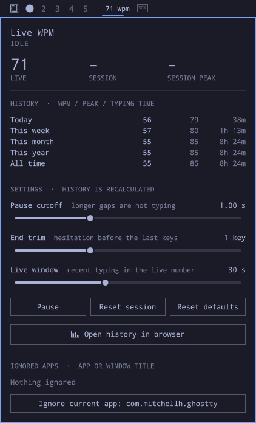
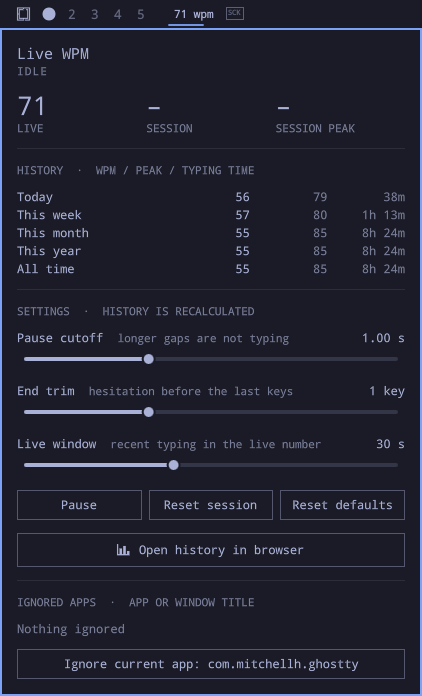
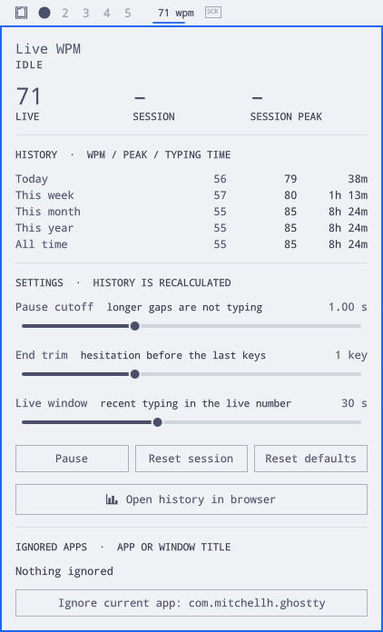
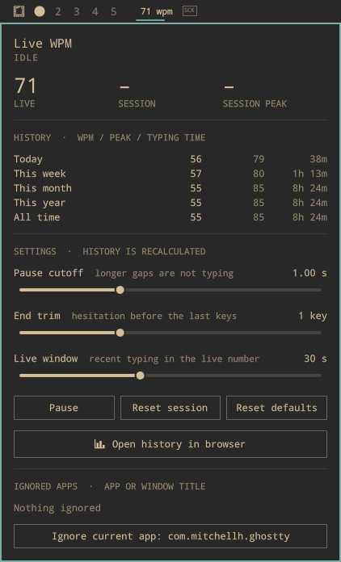

# Live WPM



Your real typing speed in the Omarchy bar, measured while you work in any app.

- **Live WPM in the bar.** The speed of your last 30 seconds of typing, with a
  green dot while you type.
- **Session and history.** Session speed and peak, plus today, this week, this
  month, this year and all time. A history page in the browser shows it as a
  chart.
- **Timings only.** The plugin stores when a key was pressed, never which key.
- **Honest numbers.** Thinking pauses are not typing, corrections take letters
  back, key mashing and games are left out.

It is not a typing test. There is no text to copy, so it cannot see mistakes.
It measures speed, not accuracy.

## Themes

The widget takes its colors from your Omarchy theme. Here it is in three of
the stock themes.

| Tokyo Night | Catppuccin Latte | Gruvbox |
|---|---|---|
|  |  |  |

## Install

Requires Omarchy 4 (tested on 4.5.0). It uses Python 3 from the system, with
the standard library only, and Hyprland's `hyprctl`.

```bash
omarchy plugin add https://github.com/TonciZ/omarchy-live-wpm.git --enable
```

Then give it keyboard access. See the next section, it is the one manual step.

Remove it with:

```bash
omarchy plugin remove io.github.tonciz.live-wpm
```

That leaves your history and settings in place. To delete those too:

```bash
rm -rf ~/.local/share/omarchy-live-wpm ~/.config/omarchy-live-wpm
```

## Keyboard access (read this first)

Wayland does not let a normal program see keys typed into other apps. So the
plugin reads the keyboard devices in `/dev/input` directly, read-only. For
that, your user must be in the `input` group.

Omarchy does not put you in that group. It was removed on purpose, because a
member of `input` can read every key press, and so can any other program you
run. Adding yourself is a real security trade-off, not a formality. Do it only
if you accept that.

```bash
sudo gpasswd -a "$USER" input
```

Log out and back in. To undo it later:

```bash
sudo gpasswd -d "$USER" input
```

Without access nothing breaks. The bar shows `– wpm` and the popup says
**No keyboard access (input group)**. The plugin never asks for a password,
never changes groups by itself and installs no udev rules.

## What is stored

For every counted key press the plugin saves one number:

- the time since the previous key press, in milliseconds
- whether it was a character or a deletion
- for a deletion, how many letters it took back

It never saves, prints or sends which key was pressed. Key codes are looked at
only to sort a press into "character", "Backspace" or "ignore". Window titles
are compared with your ignore list in memory and never saved. Nothing goes
over the network. The history page is a local file.

Key presses in password fields are counted like any others, as timings. Use
**Pause** or the ignore list if you do not want that.

| What | Where |
|---|---|
| One file of timings per day | `~/.local/share/omarchy-live-wpm/days/` |
| History page | `~/.local/share/omarchy-live-wpm/report.html` |
| Settings and ignore list | `~/.config/omarchy-live-wpm/settings.json` |

## How the speed is calculated

WPM is characters divided by 5, divided by minutes of typing. The work is in
deciding what counts as a character and what counts as typing time.

| Rule | What it does |
|---|---|
| Pause cutoff | A gap longer than 1 second between two keys is not typing. It is dropped and a new burst starts. |
| Short bursts | A burst of fewer than 10 keys is dropped. This removes shortcuts, short commands and menu keys. |
| First key | The first key of a burst adds no time and no character. Speed is counted between keys. |
| Backspace | Takes one letter back. Holding it takes back every letter it removed, estimated from how long it was held. |
| Ctrl+Backspace | Takes back the whole word it removed. The plugin keeps the lengths of your recent words in memory for this, lengths only. |
| End trim | A hesitation of 0.4 seconds or more before the last key of a burst is dropped. Think of reading a line over and then pressing Enter. |
| Key mashing | A burst where 40% or more of the keys land within 30 ms of the previous key is dropped. That is a game or a keyboard test, not writing. |
| Held keys | A held letter key counts once. Auto-repeat is ignored. |
| Shortcuts | Keys pressed with Ctrl, Alt or Super are ignored. Shift and AltGr are fine. |

Totals for a week, a month or a year are the sum of characters over the sum of
typing time. They are never an average of daily averages.

Session and history speeds appear after 10 seconds of typing. The live number
appears after 2 seconds. **Peak** is your best 30 seconds of typing.

### How it compares with Monkeytype

In a simulation of 400 typing tests, scored with Monkeytype's own formula and
with this plugin, a careful test lands within about 1 WPM. The plugin reads
higher in three cases, because it cannot see what Monkeytype sees:

- **Mistakes you leave in.** Monkeytype gives no credit for a word with a
  mistake in it. The plugin counts those letters.
- **Stops longer than the pause cutoff.** Monkeytype counts them as test time.
  The plugin drops them, which is the point when you write and think.
- **Free typing is not a test.** Your daily average is your speed at a
  1 second pause cutoff. A longer cutoff gives a lower number.

You can run the simulation yourself with `python3 tests/sim_monkeytype.py`. It
needs no keyboard.

## The popup

Click the bar label.

- **Live, session and session peak** at the top.
- **History** rows with speed, peak and typing time.
- **Three sliders.** History is recalculated when you move one.

  | Slider | Range | Default |
  |---|---|---|
  | Pause cutoff | 0.5 to 2.0 s | 1.0 s |
  | End trim | off to 3 keys | 1 key |
  | Live window | 10 to 60 s | 30 s |

- **Pause**, **Reset session** and **Reset defaults**. Reset defaults keeps
  your ignore list.
- **Open history in browser** builds the history page and opens it.
- **Ignored apps.** "Ignore current app" adds the focused app. Entries are
  regular expressions matched against the app class or the window title, so a
  title pattern also catches a game streamed in a browser tab. The list is
  empty at first.

The other rules (minimum burst, end hesitation, peak window, peak minimum) have
no slider. They can be changed in `settings.json`, or with
`scripts/wpm-reader.py --set min_burst_keys=5`.

## Commands

```bash
omarchy-shell io.github.tonciz.live-wpm togglePause
omarchy-shell io.github.tonciz.live-wpm resetSession
omarchy-shell io.github.tonciz.live-wpm openReport
omarchy-shell io.github.tonciz.live-wpm state
```

`state` prints the current numbers as JSON.

## Limits

- Speed only. No accuracy, because the plugin does not know what you meant to
  type.
- Ctrl+Backspace is sized by words split at spaces. Where an app stops at
  punctuation the plugin takes back a little too much. After an arrow key, Enter, a
  shortcut, a window switch or 10 seconds without a key it falls back to one
  letter.
- A mouse click that moves the text cursor is not seen.
- Typing sent to another computer through a software KVM is counted too,
  because the keys are still pressed on this keyboard.
- Dead keys and compose sequences count as one character per key press.

## Tests

```bash
python3 -m unittest discover -s tests
python3 tests/sim_monkeytype.py
```

## License

MIT, see [LICENSE](LICENSE).
